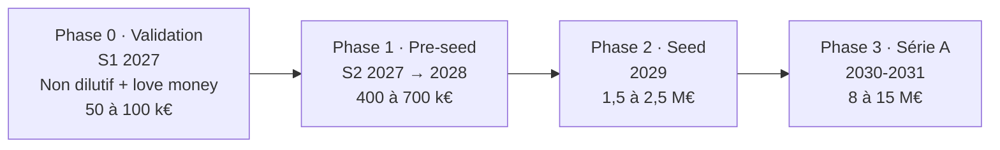

# Compléments de cadrage

> Compléments à la [fiche de cadrage V5](../Cadrage%20V5.pdf), issus du benchmark. Rédigés avec Claude, à valider par l'équipe.

## A1. Positionnement issu du benchmark

> **Billes est le compte où la famille investit dans l'autonomie financière d'un jeune adulte, et où chaque euro reçu devient une leçon.**

- **Aucun acteur identifié ne combine les 4 briques** : agrégation, compte alimenté par les proches, don engagé et coach IA éducatif pour les 18-25 ans.
- **L'agrégation et le coach IA ne différencient plus.** L'agrégation s'achète (Powens, Bridge, Tink). Le coach IA est devenu standard (Revolut AIR, Sumeria SIA, Pixpay, Finary, Cleo).
- **L'espace libre** a trois dimensions :
  - les 18-25 ans restent sans pédagogie : les néobanques pour ados s'arrêtent à 18 ans, et les banques recrutent les jeunes à environ 3 €/mois sans aucun outil éducatif ;
  - aucun acteur français ne s'adresse aux **grands-parents donateurs** ;
  - aucun ne propose un **don engagé qui arrive à 100 % au jeune**.

## A2. Modèle économique (pistes à chiffrer dans le devis)

**Principe directeur** : 100 % de la valeur donnée arrive au jeune. Billes ne garde aucun solde non dépensé, ne prélève aucun frais de dormance et ne propose ni crédit ni avance. C'est un argument face aux cartes cadeaux classiques et une protection contre le cas Cleo, dont les clients sont remboursés à la demande de la FTC, l'autorité américaine de protection des consommateurs.

| Flux | Mécanisme | Repère de prix | Niveau de preuve |
|---|---|---|---|
| **1. Frais donateur** | 1 à 2 € par carte ou 2 à 3 % ; gratuit si l'argent reste sur le compte Billes | Trade Republic : 1 € par cadeau ; cagnottes : 4 à 6 % | Hypothèse, à tester en entretiens |
| **2. B2B employeurs et CSE** | « Carte autonomie » offerte lors des événements où les cadeaux aux salariés sont exonérés (200 € par salarié et par événement en 2026) | Le B2B représente 53 % des activations de cartes cadeaux ; Glady : 57,5 M€ de chiffre d'affaires | Canal prouvé ; éligibilité à vérifier quand le bénéficiaire est l'enfant majeur d'un salarié |
| **3. Premium pédagogique** | Coach de base gratuit, premium à 3-5 €/mois | Pixpay 3,99 € ; Cleo 5,99 $ ; Finary 149,99 €/an | Hypothèse |
| **4. Licence en marque blanche** | Coach et parcours vendus aux banques régionales, mutuelles et écoles | Zogo : plus de 200 institutions aux États-Unis | Prouvé aux États-Unis, pas en France |
| **5. Revenus de compte** | Part de la commission perçue sur les paiements par carte, partagée avec le partenaire de paiement | Swan | Non documenté |

*Ce qu'on exclut : publicité, revente de données, affiliation à des courtiers. L'affiliation ferait entrer Billes dans la communication financière encadrée par l'AMF.*

## A3. Roadmap produit et financement (projection illustrative)

> Le service est fictif : cette roadmap montre comment Billes serait lancé et financé s'il devenait une entreprise. Les montants sont des **ordres de grandeur issus de repères publics** ; les seuils de passage d'une phase à l'autre sont des **hypothèses à calibrer** dans le devis (D) et les KPI (E).

### Principe : chaque levée finance la preuve qui débloque la suivante

| Phase | Objectif produit | Ce que finance la phase | Condition pour passer à la suivante (hypothèse) | Financement et montant indicatif |
|---|---|---|---|---|
| **0 · Validation** (S1 2027) | Prouver le besoin des deux côtés | Création de la société, entretiens à grande échelle, maquette testée, POC étendu, premiers échanges avec Swan et un agrégateur | Les deux hypothèses validées en entretiens ; lettres d'intention de 2 ou 3 CSE ; équipe fondatrice constituée | **Non dilutif et love money, 50 à 100 k€** : Bourse French Tech de Bpifrance (jusqu'à 30 k€, dans la limite de 70 % des dépenses), prêts d'honneur, incubateur |
| **1 · Pre-seed** (S2 2027 → 2028) | MVP réel en bêta fermée | MVP sur partenaire BaaS et agrégateur, coach IA, AIPD, audit RGAA, 3 à 5 personnes pendant 18 mois | Environ 500 familles en bêta ; progression mesurée sur le quiz ; donateurs qui renouvellent ; 2 ou 3 pilotes CSE payants | **400 à 700 k€** auprès de business angels et de fonds pre-seed fintech (fourchette pre-seed française : 100 k€ à 1 M€) |
| **2 · Seed** (2029) | Lancement public et canal B2B | Ouverture au grand public, carte cadeau physique, comptes mineurs (V2), simulateur d'investissement fictif, 10 à 15 personnes | Revenus B2B récurrents ; coût d'acquisition par donateur maîtrisé ; premier contrat de marque blanche ; KPI pédagogiques atteints | **1,5 à 2,5 M€** (médiane des seeds français fin 2025 : 2 M€ ; Pixpay a levé 3,1 M€ avant son lancement en 2020) |
| **3 · Série A** (2030-2031) | Passage à l'échelle | Marque blanche auprès des banques régionales et mutuelles, ouverture à d'autres pays francophones, décision sur un agrément d'établissement de monnaie électronique en propre | — | **8 à 15 M€** (Pixpay a levé 8 M€ en 2021 avec 10 000 utilisateurs ; une série A française va de quelques millions à une quinzaine de millions d'euros) |

### Points d'attention
- **Le passage du seed à la série A est devenu difficile** : environ 12 % des startups ayant levé en seed au 1er trimestre 2022 ont atteint la série A en deux ans, contre 31,8 % pour la cohorte de 2020 (Crunchbase, cité par Magstartup). Il faut donc un **plan B sans série A** : rentabilité par le B2B et la marque blanche.
- **Le plan B le plus crédible est l'adossement à un acteur mutualiste ou bancaire.** C'est le chemin de Mon Petit Placement : 650 k€ en 2018, 1,5 M€ en 2020, 6 M€ en 2023 lors de son rapprochement avec La France Mutualiste, soit environ 14,5 M€ au total. Les mutuelles et banques régionales sont aussi les clients naturels de la marque blanche.
- **Dilution** : un tour cède en général 15 à 25 % du capital (Carta, 2025-2026). Lever le minimum utile à chaque phase.
- **Agrément en propre** : un établissement de monnaie électronique doit disposer d'un capital initial d'au moins 350 k€, sans compter le coût de la conformité. Ce choix n'a de sens qu'après la série A.
- **Calendrier réglementaire à intégrer** :
  - obligations de l'AI Act pour les systèmes à haut risque reportées au 02/12/2027 : le coach ne doit pas évaluer la solvabilité ;
  - DSP3 et le règlement sur les services de paiement : pas d'application avant 2028, à anticiper pour l'initiation de paiement en phase 2 ;
  - FiDA (accès élargi aux données financières, y compris l'épargne) : au point mort.

*Sources des repères : [Licorne Society](https://www.licornesociety.com/levees-de-fonds) (définitions des tours), [Magstartup](https://www.magstartup.com/seed-funding/) (médiane seed France, conversion seed → A), [Bpifrance / Flag](https://flag.finance/en/blog/bourse-french-tech-et-emergence-le-tremplin-pour-ton-projet-tech-ou-deeptech/) (Bourse French Tech), [Les Échos Entrepreneurs](https://entrepreneurs.lesechos.fr/creation-entreprise/aides-financements/pixpay-la-neobanque-pour-ados-leve-8-millions-deuros-1995937) et [JDN](https://www.journaldunet.com/fintech/1423779-pixpay-leve-3-1-millions-d-euros-pour-sa-neobanque-dediee-aux-ados/) (Pixpay), [Bpifrance presse](https://presse.bpifrance.fr/la-fintech-mon-petit-placement-leve-6-millions-deuros-afin-de-devenir-le-leader-de-linvestissement-pour-les-particuliers-en-france) (Mon Petit Placement), [Waveup / Carta](https://waveup.com/blog/startup-funding-stages/) (dilution). Capital minimal d'un EME : directive 2009/110/CE, art. 4. Montants des prêts d'honneur à vérifier auprès des réseaux (Initiative France, Réseau Entreprendre).*

## A4. KPI pressentis (calibrés sur des références publiques)

Chaque cible consiste à **ramener les utilisateurs de Billes au niveau de la moyenne nationale** : aucun chiffre n'est inventé.

| KPI | Formule | Point de départ public | Cible |
|---|---|---|---|
| Engagement des donateurs | Part des bénéficiaires actifs ayant reçu au moins un don engagé sur 90 jours, et montant moyen reçu | 71 % des ados reçoivent ponctuellement de l'argent de leurs grands-parents ; 202 € par an et par petit-enfant (Ifop 2021) | À fixer après les entretiens |
| Progression pédagogique | Score à un quiz de sortie moins score à un quiz d'entrée, construits sur les questions de l'enquête OCDE/EDUCFI | 18-24 ans : 60,3/100 ; 40 % savent ce que sont des agios | 64/100 et 68 % (moyenne nationale) |
| Santé budgétaire | Part des bénéficiaires à découvert non autorisé sur leurs comptes agrégés | 14 % des 18-24 ans, contre 8 % de l'ensemble des Français | Moins de 8 % |

## A5. Cadre réglementaire à positionner dans l'architecture (livrable B)

| Brique | Statut réel requis | Option retenue pour le projet (simulé) | Alternative à argumenter |
|---|---|---|---|
| Agrégation de comptes | Prestataire de services d'information sur les comptes (DSP2, enregistrement ACPR). Consentement à renouveler tous les 180 jours | Passer par un **agrégateur agréé** (API d'agrégation), données simulées | Obtenir son propre agrément |
| Compte Billes + cartes cadeaux | Établissement de monnaie électronique ou de paiement | Partenaire **Banking-as-a-Service** agréé ; Billes agit en tant que distributeur | Agrément en propre : coûteux et long, mais plus de maîtrise (envisagé en série A, voir A3) |
| Coach « investir » | Le **conseil en investissement personnalisé** est une activité réglementée (CIF, AMF) | Le coach reste **éducatif** : budget, épargne, notions générales. Il ne recommande jamais de produit financier | Partenariat futur avec un CIF agréé |
