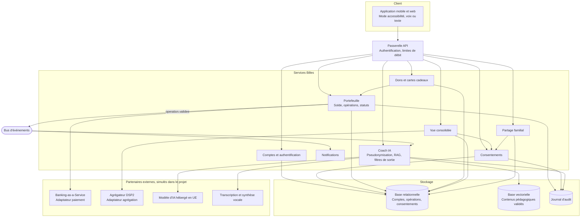
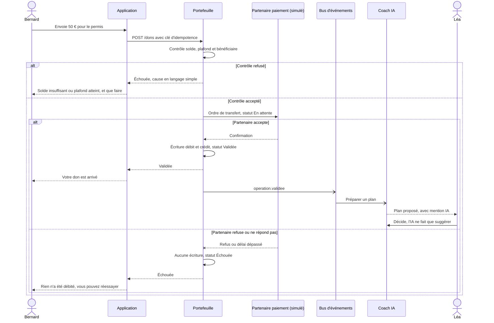
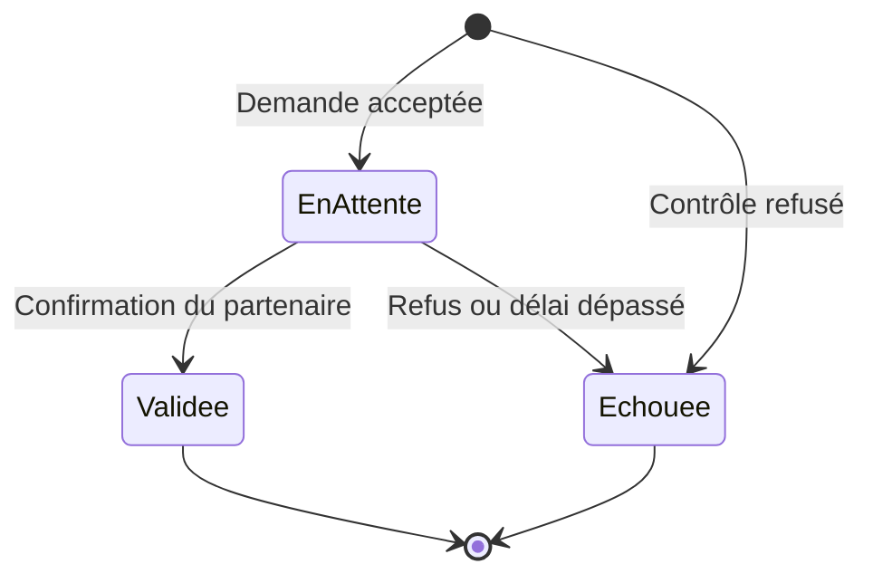
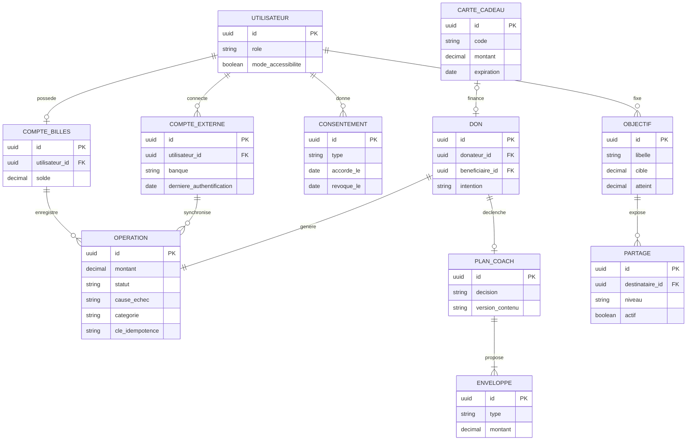

# Architecture SI initiale (livrable B)

> **v0 à valider par Matthieu Baric.** Ébauche rédigée avec Claude à partir de la fiche de cadrage V5 et du benchmark. Elle sera approfondie pour le dépôt 2 du 13/11.

## Principes

1. **Les fonctions réglementées sont confiées à des partenaires agréés.** Billes garde l'expérience, le coach et la relation client.
2. **Les prestataires sont interchangeables.** Chaque partenaire est appelé à travers un adaptateur, pour éviter le scénario Kard, liquidé après la rupture de contrat de son prestataire.
3. **Le portefeuille fonctionne sans l'IA.** Un don aboutit même si le coach est indisponible : le coach réagit à un événement et ne bloque jamais le transfert.
4. **Les données partagées sont séparées des données privées.** Le service de partage ne lit jamais le détail des opérations.
5. **Le modèle d'IA ne reçoit que des données pseudonymisées.** Aucun libellé de transaction ne lui est envoyé en clair.

## Composants, services, API et stockage

Dans le projet, tous les partenaires externes sont **simulés** par des bouchons.

### API principales (premières pistes)

| Méthode et route | Rôle | Fonction imposée |
|---|---|---|
| `POST /auth/inscription`, `POST /auth/connexion` | Créer un compte, s'authentifier | 1 |
| `GET /comptes/vue-consolidee` | Soldes des comptes externes et du compte Billes | 2 |
| `GET /operations` | Historique catégorisé | 2 |
| `POST /rechargements` | Rechargement par carte fictive ou code de carte cadeau | 3 |
| `POST /dons` | Coup de pouce, avec clé d'idempotence | 4 |
| `GET /operations/{id}` | Statut et cause d'échec | 5 |
| `GET` et `PUT /securite/parametres` | Plafonds, appareils, mode accessibilité | 6 |
| `GET` et `PUT /consentements` | Agrégation, IA, partage familial | 6 |
| `GET /coach/plans/{donId}`, `POST /coach/plans/{donId}/decision` | Consulter le plan, décider | Coach IA |

## Flux d'un transfert, nominal et échec

- **Idempotence** : renvoyer une requête avec la même clé ne crée pas de deuxième don.
- **Coach indisponible** : l'événement reste en file d'attente, le don est déjà validé et le plan arrive plus tard.

### Cycle de vie d'une opération

## Modèle de données synthétique

## Position de l'IA

| Point | Choix |
|---|---|
| Déclenchement | Asynchrone, après un événement `operation.validee`, ou à la demande de l'utilisateur |
| Entrées | Profil structuré et opérations **pseudonymisées**, sans les données de partage familial |
| Sources du coach | Contenus pédagogiques validés, par RAG |
| Sorties | Filtre bloquant toute recommandation de produit financier, mention IA systématique |
| Décision | Toujours prise par l'utilisateur, aucune action automatique sur le solde |
| Traçabilité | Version du contenu et décision conservées dans `PLAN_COACH`, journal d'audit |
| Voix | Transcription et synthèse uniquement, audio supprimé après traitement, jamais d'identification du locuteur |

## Alternative argumentée : partenaire agréé ou agrément en propre

| Critère | **Partenaire agréé (retenu)** | Agrément d'établissement de monnaie électronique en propre |
|---|---|---|
| Coût d'entrée | À partir de 2 990 €/mois chez Swan, soit 35 880 €/an | 350 000 € de capital, plus une fonction conformité permanente |
| Délai | Quelques mois (à confirmer) | Environ un an de préparation |
| Sécurité et conformité | Le partenaire porte l'essentiel des obligations réglementaires | Maîtrise complète, responsabilité complète |
| Échelle | Dépendance au prestataire, marge partagée | Marge et feuille de route maîtrisées |
| Risque principal | Rupture de contrat, couverte par les adaptateurs et un deuxième prestataire | Coût fixe élevé avant toute traction |

**Choix** : partenaire agréé pour le MVP. L'agrément en propre ne se justifie qu'à grande échelle, voir la [roadmap de financement](annexes-cadrage.md#a3-roadmap-produit-et-financement-projection-illustrative).

## À trancher pour le 13/11

- Monolithe modulaire ou services séparés : le découpage ci-dessus est **logique**. Un seul déployable semble suffisant pour un MVP, à argumenter.
- Choix de l'hébergeur en UE et de la base vectorielle.
- Choix du fournisseur de modèle d'IA, selon le prix et les garanties de non-réutilisation des données.
- Qui gère le renouvellement de l'authentification forte tous les 180 jours : Billes ou l'agrégateur.
