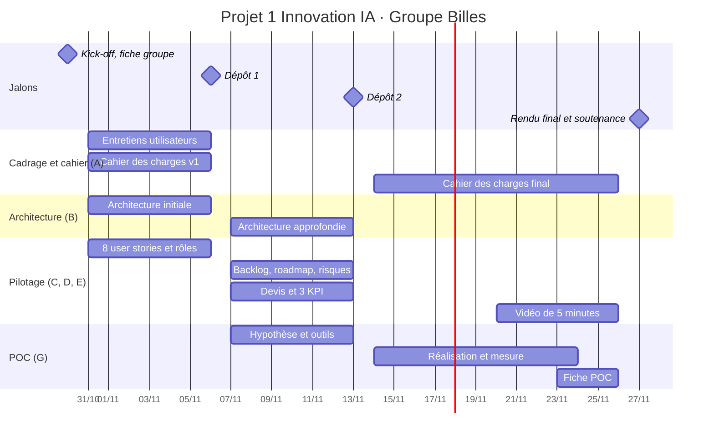

# Roadmap du projet

> Le suivi quotidien se fait dans l'onglet Projects. Cette page donne la vue d'ensemble des quatre jalons.

| Jalon | Attendu officiel | Responsable principal |
|---|---|---|
| **30/10 · Kick-off** | Groupe, problème, cibles, personas, MVP, piste IA (fiche de cadrage) | Maxime |
| **06/11 · Dépôt 1** | Groupe inscrit, premier cahier, MVP, IA, architecture initiale, 8 stories, rôles | Maxime, Matthieu, Lilou |
| **13/11 · Dépôt 2** | Architecture approfondie, backlog, roadmap, devis, 3 KPI, risques, hypothèse et outils du POC | Matthieu, Lena, Lilou |
| **27/11 · Final** | Livrables A à G, POC en direct, fiche POC, vidéo de 5 minutes, soutenance individuelle | Tous |

